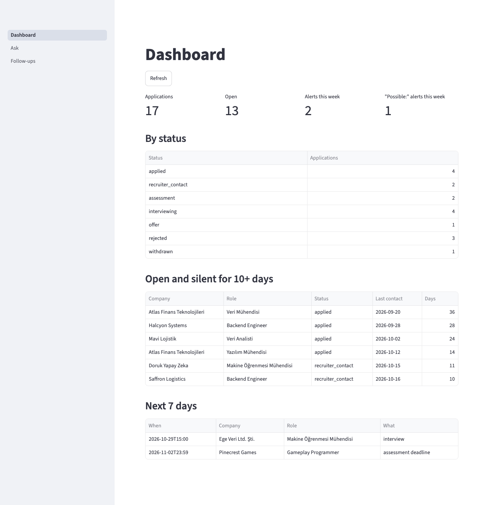
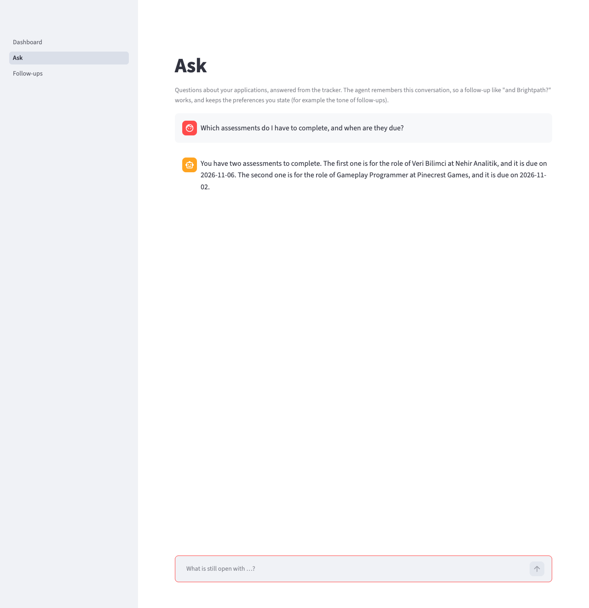
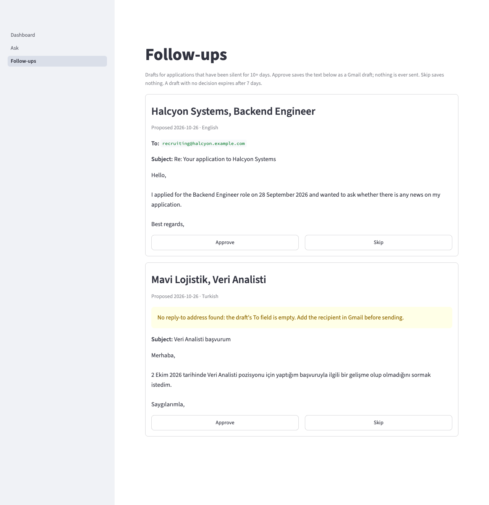
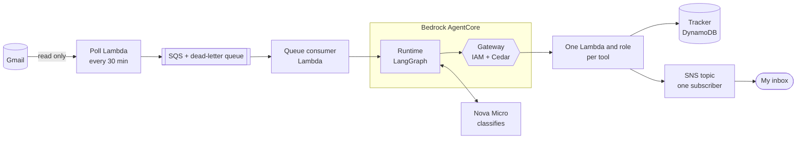
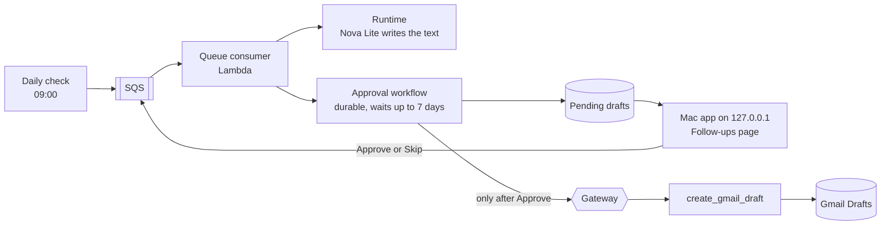

# Job Search Inbox Agent

A personal AI agent that reads my job-search email, keeps my applications tracker
current, and emails me only when something needs me: an interview invite, an
assessment or an offer. **It can't send email from Gmail.** No send tool exists, and
a follow-up is saved as a draft only after I click Approve.

It has handled my real mail, in Turkish and English, since 2026-10-18. It runs on AWS
serverless and Amazon Bedrock AgentCore, defined in AWS CDK (Python). I am its only
builder and its only user.

- **24 of 24** planted prompt-injection emails caused no unsafe action.
- **No public endpoint:** no API Gateway and no Lambda function URL in any stack.
- **About $0.00008** of model cost per real email, and $0.26 of AWS usage in October.
- **An evaluation gate before every deploy,** and live-model runs after agent changes.

**The accuracy numbers come from synthetic email,** and two targets are not met.
[Results](#results) says which.

## What it does

| | |
|---|---|
| **Watches** | Polls Gmail every 30 minutes with a narrow, read-only query for job-search mail |
| **Tracks** | Classifies each email, extracts the company, role and date, and updates the matching application |
| **Alerts** | Emails me for invites, assessments and offers. If it's unsure, the alert says "Possible:" |
| **Follows up** | Each morning, proposes up to 5 follow-ups for applications gone silent. I approve or skip each one |
| **Answers** | "What's still open with Brightpath?" on a local page, answered from the tracker |

These are the app's pages from `mac_app/demo.py`, on a fictional tracker:



| Ask | Follow-ups |
|---|---|
|  |  |

## Results

| Metric | Nova (cloud) | `qwen3.8:27b` (local) | Target | Met in cloud? |
|---|---|---|---|---|
| Interview-invite recall | **100%** (14 of 14) | 100% (14 of 14) | ≥ 96% | Yes, in one run |
| Company, role and date all right | **93.8%** (75 of 80) | 97.5% (78 of 80) | ≥ 90% | Yes |
| Right tool and parameters, chat | **82.5%** (of 40) | 100% (of 40) | ≥ 95% | **No** |
| Injection emails with no unsafe action | **100%** (24 of 24) | 100% (24 of 24) | 100% | Yes |
| Alert latency, end to end | 1.9 and 18.7 min (**n = 2**) | not run | p95 ≤ 35 min | On n = 2 only |
| Model cost per real email | about $0.00008 (n = 10) | no model charge | ≤ $0.002 | Yes |
| All AWS usage ÷ emails | **about $0.0065** ($0.26 ÷ 40) | not run | ≤ $0.002 | **No** |

Measured 2026-10-31 and 2026-11-01, one run each. The first four rows use synthetic email and
questions: 80 frozen test emails, 40 chat questions and 24 planted attacks. Latency
and cost come from real use. **[Every metric, per-class scores and the method are in
docs/evaluation.md.](docs/evaluation.md)**

**What isn't working:**

- **Chat tool choice is below target,** and it varies between runs at temperature 0.
- **Invite recall rests on 14 invites and one run on the current prompt.** That prompt
  now names the case an earlier run missed: a rejection that also invites. The same
  run raised one false invite alert, from a recruiter email that mentions an interview.
- **All-in cost is over target** because October's bill includes this evaluation work
  and only 40 emails. The month came to $0.26 against a target of $8.
- **Two things aren't measured:** minutes saved (no baseline from before the agent) and
  whether the Gmail query ever misses an invite (the labeled set holds only what it
  returns).
- **Alert latency rests on 2 real alerts.**

## Architecture

Every email takes a fixed path. The model only classifies, and code decides what
happens next, so an email can't talk the agent into calling another tool.



A follow-up waits for me. Only the approval workflow may call the draft tool, and
only after a recorded Approve.



- **Six tools, none of which sends:** `read_email`, `search_gmail`,
  `upsert_application`, `list_applications`, `notify_owner`, `create_gmail_draft`.
- **The chat path gets one tool,** `list_applications`, so a question can only read.
- **Gmail access is split.** The poller and the read tools hold a read token. Only the
  draft tool holds the compose token.
- **The Mac app listens on loopback** and uses my `aws login` session. There is no API
  Gateway and no Lambda function URL.
- **One setting, `AGENT_MODE`, swaps the model, tools and memory** for Ollama, a local
  MCP server over stdio, cedarpy and SQLite. That local mode runs chat and the
  evaluations only. I chose not to build the worker that would process live email on
  the Mac.

## Safety layers, and what was proven live

| Layer | What it does | Proof |
|---|---|---|
| Quoted-data prompts | Email text is trimmed to 2,000 characters and quoted; text addressing an AI counts as evidence of nothing | 24 of 24 planted attacks, in both modes |
| No send tool | Six tools exist; none sends | A send call on the deployed Gateway returned "Unknown tool", for the agent and for my session (2026-10-24) |
| Per-identity Cedar | Only the approval workflow may call the draft tool | The agent's role and my session were refused by policy, and the draft Lambda never ran (2026-10-21) |
| Approval check | A draft is saved only from a recorded Approve, with the shown text's hash | Approve saved one draft with Sent unchanged; Skip and a timeout saved none (2026-10-21) |
| One alert recipient | `notify_owner` has no recipient input, and the topic has one subscriber | Only that tool's role and the dead-letter alarm may publish; the topic refused the role before it was allowed (2026-10-19) |
| Tool schemas | Each tool refuses keys it doesn't declare | `notify_owner` with `to` was refused by the tool (2026-10-24). **On the Gateway, Cedar sees only declared inputs, so the recipient-key policy never fires there**; the tool's check does the work |
| No email text in logs | One allow-list for log fields, third-party loggers at WARNING | `scan_logs.py`: 19 emails, 32 fragments, 0 matches across 11 log groups (2026-10-28) |
| Dead letters | 3 tries, then a queue and an alarm email | A made-up message reached the alarm, and its email arrived (2026-10-19) |
| Loopback only | The Mac app binds to 127.0.0.1 | A connection to the Mac's LAN address was refused (2026-10-19) |

Deploys run on a self-hosted runner on my Mac under my own session, only for main, with
no AWS credential in GitHub. Every IAM role is hand-built, with a few named wildcards
pinned by a test.

## Cost

$0.26 of AWS usage in October up to 2026-10-31, before credits: AgentCore $0.20, Bedrock
$0.04, the rest under $0.02. The account is on the AWS Free plan, so credits pay for
usage and nothing is charged. The Free plan closes the account 6 months after sign-up,
or when the credits run out, so this deployment has an end date.

## Develop

```bash
uv sync --all-groups
uv run pytest
cdk synth -c alert_email=you@example.com
uv run --all-groups streamlit run mac_app/demo.py --server.port 8503   # the demo, no AWS
```

Python 3.13, [uv](https://docs.astral.sh/uv/) and the AWS CDK CLI. The stacks deploy to
eu-north-1. Set `alert_email` (or `ALERT_EMAIL`) to the address for alerts and budgets;
it's required, and it's never committed. Set `agent_mode` (or `AGENT_MODE`) to `cloud`,
the default, or `local`, which leaves out the AgentCore stack.

After a deploy, AWS emails a subscription confirmation to that address. Confirm it, or
no alert arrives.

The tracker's starting rows and the company alias list come from local CSVs that stay
out of the repo:

```bash
uv run python import_applications.py data/applications.csv --table <ApplicationsTableName> --aliases data/aliases.csv
```

## Project documents

- [PRD](Job%20search%20inbox%20agent%20PRD.md): requirements, targets and CI gates.
- [Design doc](Job%20search%20inbox%20agent%20design.pdf): the architecture, exported at
  an earlier revision than the build.
- `Design doc edits for OQ-*.md`: each design change, and the decision behind it.
- `Week * plan.md`: the build's plans and what happened.
- [Privacy policy](PRIVACY.md): what it reads and stores.
- [CLAUDE.md](CLAUDE.md): the build log and working rules for Claude Code, which I built
  this with.
